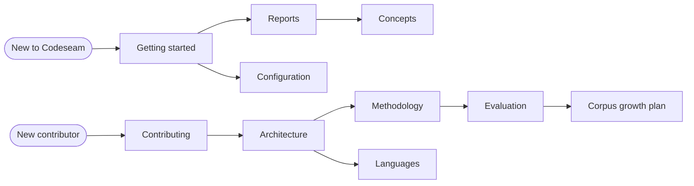

# Codeseam documentation

Codeseam finds repeated code in a repository. It tells you which repetitions are worth a refactor, and which are not.

This folder contains the documentation for users and for contributors. Each document has one subject. Start with the document that matches your task.

## Which document to read

| Document | Read it when you want to... |
|---|---|
| [Getting started](getting-started.md) | Install Codeseam, do your first analysis, and read the results. |
| [Concepts](concepts.md) | Learn the words that the reports and the code use. |
| [Reports](reports.md) | Understand each report file, each field, and the exit codes. |
| [Configuration](configuration.md) | Change what Codeseam analyses and how it decides. |
| [Methodology](methodology.md) | Learn how Codeseam finds, compares, and assesses repeated code. |
| [Architecture](architecture.md) | Find your way in the source code and its layers. |
| [Languages](languages.md) | Learn how Python and TypeScript/JavaScript are parsed, or add a language. |
| [Evaluation](evaluation.md) | Measure a change with the labelled corpus and the benchmark. |
| [Corpus growth plan](corpus-growth.md) | Grow the labelled corpus with little data and little time. |
| [Contributing](contributing.md) | Set up a development environment and make a change. |

## Reading paths

## Writing rules for these documents

These documents use ASD-STE100 Simplified Technical English. The rules make the text easy to read and easy to translate:

- One sentence gives one instruction or one fact.
- An instruction has 20 words or fewer. A description has 25 words or fewer.
- Instructions use the imperative ("Run the command").
- Technical names (`codeseam analyze`, `ReviewTier`) keep their exact spelling.
- A note starts with **NOTE:**. A risk to data or results starts with **CAUTION:**.

Keep these rules when you change a document.
