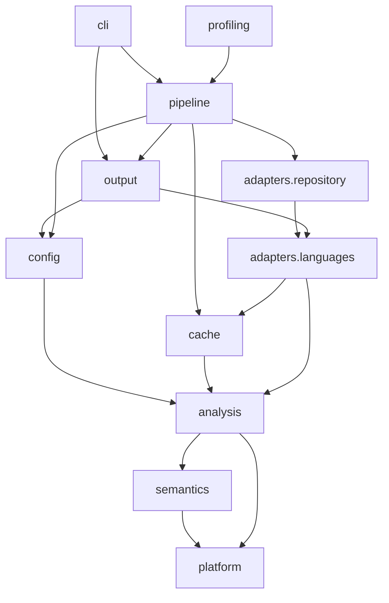
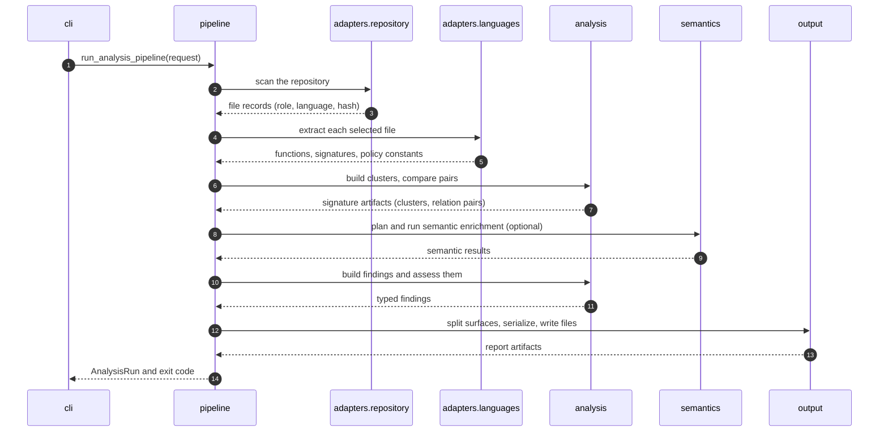

# Architecture

This document describes the structure of the source code: the packages, the layers between them, and the path of one analysis run.

## Packages

All source code is in `src/codeseam/`.

| Package | Responsibility |
|---|---|
| `cli/` | Reads the command line, runs a command, and prints the result. |
| `pipeline/` | Runs the steps of an analysis in sequence. |
| `config.py` | Reads, checks and merges the settings into one read-only `Config`. |
| `adapters/repository/` | Walks the repository, selects files, gives roles, and hashes content. |
| `adapters/languages/` | Parses source files. One adapter for each language family. |
| `analysis/` | The language-neutral analysis: signatures, relations, findings and assessment. |
| `cache/` | The persistent cache (SQLite) and the cache keys. |
| `semantics/` | The optional semantic provider: requests, protocol and trust policy. |
| `output/` | Serializes findings and writes the report files. |
| `platform/` | Small shared helpers: paths, hashing, JSON, files, locks, errors. |
| `profiling/` | Profiles an analysis run (`codeseam profile`). |
| `resources/` | Default configuration files and the TypeScript semantic worker. |

The `analysis/` package has these subpackages:

| Subpackage | Responsibility |
|---|---|
| `analysis/repository/` | Repository facts and path classification. |
| `analysis/inventory/` | The function inventory and the shared function model (`FunctionIR`). |
| `analysis/signatures/` | Signature records, shapes, the shared vocabulary, and policy constant models. |
| `analysis/relations/` | Candidate generation, pair comparison, scores, deltas and shared blocks. |
| `analysis/findings/` | Finding drafts, finding models, identity and the typed surface split. |
| `analysis/assessment/` | Clusters, the five-part assessment, semantic caps and review tiers. |

## Layers

Each package can import only from the packages below it. There are no import cycles.

Keep these rules when you add code:

- `analysis/` does not know any language syntax. Language rules stay in `adapters/languages/`.
- `analysis/` does not read files or the cache. The pipeline gives it typed data.
- `output/` does not make decisions. It serializes typed findings that the assessment already decided.
- `platform/` imports nothing from the other packages.

## One analysis run

The `_AnalysisPipeline` class in `pipeline/analyze.py` runs these stages:

The pipeline writes into a staging directory. It replaces the previous reports only after all stages are complete.

## Main data types

| Type | Module | Holds |
|---|---|---|
| `Config` | `config.py` | The checked, read-only settings of one run. |
| `FileRecord` | `analysis/repository/` | One file: path, language, role, size and content hash. |
| `FunctionRecord` | `analysis/inventory/` | One function: location, counts and source. |
| `SignatureRecord`, `SignatureAnalysis` | `analysis/signatures/` | The features of one function. `SignatureAnalysis` splits them into a core, relation detail and output detail. |
| `Cluster` | `analysis/assessment/cluster/` | A group of functions and its relation pairs. |
| `RelationPair` | `analysis/relations/` | Two compared functions, with scores, deltas and a relation kind. |
| `FindingDraft` | `analysis/findings/` | The evidence and metrics of one possible finding. |
| `Finding` | `analysis/findings/` | One assessed finding, with its tier, action and target ID. |
| `SurfacedFindings` | `analysis/findings/surfacing.py` | The ranked findings, split into analysis, observations and summary. |

## Cache

The cache is one SQLite database in `cache.path`. It has one namespace for each kind of data:

| Namespace | Holds | Key includes |
|---|---|---|
| `repository_facts` | The facts of the scanned repository. | The selection and all file records. |
| `functions` | The functions of one file. | The file hash, the role and the adapter. |
| `signature_cores`, `signature_features`, `signature_output` | The signature records of one file, in three parts. | The file hash, the role and the adapter. |
| `policy_constants` | The policy constants of one file. | The file hash and the role. |
| `relation_detail_features` | The relation detail of one function. | The function content. |
| `relation_pairs` | The result of one comparison. | Both members. |
| `tree_comparisons` | One tree edit distance. | Both trees. |
| `semantic_enrichment` | One semantic provider result. | The project key and the items. |

Every cache version includes a fingerprint. The fingerprint is a hash of the Codeseam source code (including the semantic worker), the Python version and the parser package versions. When any of these change, Codeseam ignores the old cache entries.

**NOTE:** A cache entry is stored only for a file that was read without problems. A file that changed during the run, or that did not parse, is analysed again in the next run.

## Where to make a change

| You want to... | Start in |
|---|---|
| Add a setting | `config.py` (`SETTINGS`) and `resources/default_codeseam.toml` |
| Change how a language is parsed | `adapters/languages/<language>/` |
| Add a statement or control kind | `analysis/signatures/vocabulary.py`, then both adapters |
| Change how pairs are found | `analysis/relations/candidates.py`, `content.py` or `blocks.py` |
| Change how pairs are scored | `analysis/relations/scoring.py` |
| Change a threshold of the assessment | `analysis/assessment/policy.py` |
| Add or change a semantic cap | `analysis/assessment/semantic_caps.py` |
| Change a report field | `output/serializers/findings.py` |
| Add a command | `cli/spec.py` and `cli/commands/` |
