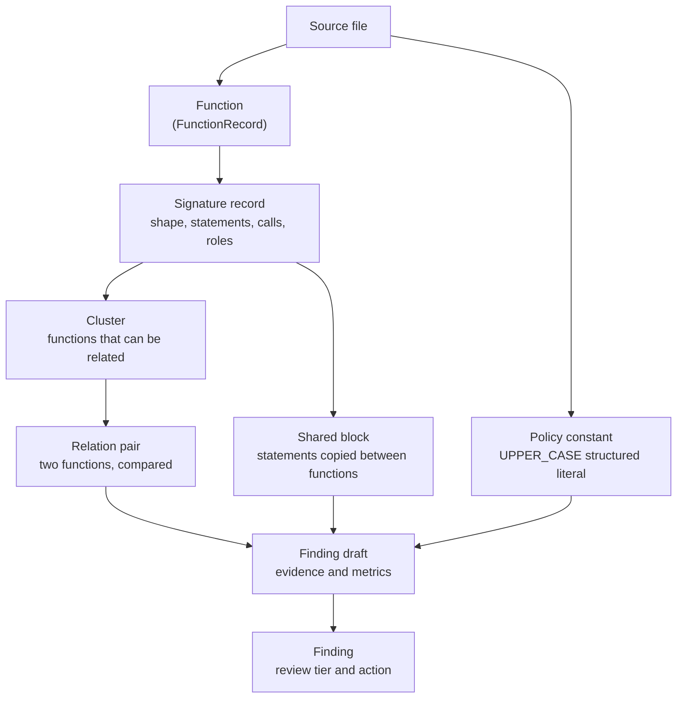
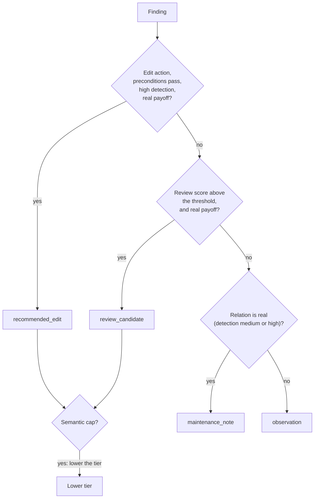

# Concepts

This document defines the words that the reports and the source code use. Each word has one meaning in Codeseam.

## From functions to findings

Codeseam works on functions. It groups similar functions, compares them in pairs, and then makes findings from the evidence.

## Units of code

- **Function**: A function, method, lambda, or arrow function that has a body. Each function has a `fn_` ID.
- **Signature record**: The facts that Codeseam extracts from one function. It has the parameter and return types, the statements, the calls, and the semantic roles. Each record has a `sigrec_` ID.
- **Signature shape**: The declared types of a function, written as `fn(<parameter types>)->return type`. An example is `fn(str,int)->bool`. A missing type is `UNKNOWN`.
- **Statement key**: A short digest of one top-level statement. The key ignores names and literal values. Thus `load(users)` and `load(orders)` have the same key. Operators, attributes and called names stay in the key.
- **Statement token**: A word that tells the kind of one top-level statement, for example `IF`, `LOOP`, `ASSIGN:BIND` or `RETURN:ARG0`. Both languages use the same tokens. Refer to [Languages](languages.md#the-shared-vocabulary).
- **Body hash**: A digest of the full normalized body of a function. Two functions with the same body hash have the same code, except for local names.
- **Body tree**: A tree of the normalized body. Codeseam measures the edit distance between two body trees.
- **Policy constant**: A module-level constant with an `UPPER_CASE` name and a structured literal value, for example a dictionary of priorities. At this time, only Python constants are extracted.

## Groups and comparisons

- **Cluster**: A group of functions that Codeseam compares with each other. There are three sources of clusters:
  - functions with the same signature shape;
  - functions with similar content, but a different shape or size (the content index);
  - a clone component that Codeseam promotes out of a large cluster.
- **Relation pair**: Two functions that Codeseam compared. A relation pair has scores (relatedness, refactorability, abstraction cost, risk, confidence) and a relation kind.
- **Relation kind**: The type of similarity between the two functions of a pair. Examples are `body_identical`, `body_parameterized` and `common_prefix_divergent_tail`. The value `none` means that there is no relation.
- **Clone type**: The clone class of a pair, as in the clone-detection literature:

| Clone type | Meaning |
|---|---|
| Type-1 | The same code. Only spaces and comments are different. |
| Type-2 | The same structure. Names or literal values are different. |
| Type-3 | Almost the same. Some statements are added, removed or changed. |
| Type-4 | The same behaviour, written in a different way. |

- **Delta**: One difference between the two functions of a pair, for example `OPERATOR_DELTA` (`+` against `-`) or `CALLEE_NAME_DELTA`. Each delta adds risk.
- **Shared block**: A run of four or more top-level statements that two or more functions have in common, while the rest of each function is different. Codeseam reports it as a partial clone.

## Findings and decisions

- **Finding** (also **review target**): One result in a report. A finding names its functions or blocks, its evidence, its review tier, and its recommended action. Each finding has an `rt_` target ID.
- **Target ID**: The stable ID of a finding, for example `rt_0123456789ab`. The ID comes from the kind of finding and its members (file and qualified name). It does not change when the tier or the evidence changes.
- **Assessment**: The analysis that changes evidence into a decision. It has five parts:

| Part | Question |
|---|---|
| Detection confidence | Is the relation real? |
| Abstraction fit | Is there one clean abstraction for the repeated code? |
| Semantic risk | Can a refactor change what the code does? |
| Maintenance payoff | Is the work worth the attention? |
| Action recommendation | Which action is best, and do its preconditions pass? |

- **Action**: What Codeseam recommends that you do:

| Action | Meaning |
|---|---|
| `consolidate_clone` | Replace the copies with one function. |
| `extract_small_helper` | Move the repeated statements into a helper function. |
| `reuse_existing_helper` | Call a helper that already exists. |
| `introduce_abstraction` | Make a shared abstraction, for example one constant or one module. |
| `record_shared_concern` | Do not change the code. Know that the copies must change together. |
| `inspect_shared_lifecycle` | Look at how the copies are used before you decide. |
| `observe` | No action. |
| `do_not_refactor` | Do not combine the copies. They must stay separate. |

- **Review tier**: The decision for a finding. Refer to the table below.
- **Semantic role**: A label for a function that changes how Codeseam assesses it. Examples are `test_code`, `constructor`, `typing_overload` and `adapter_forwarder`. A role can limit the tier of a finding (a **semantic cap**).
- **Summary eligible**: A finding that appears in `agent/summary.md` and that CI counts. All recommended edits are summary eligible. Other findings must have a real payoff, a medium or higher refactorability, and an edit action.

## Review tiers

| Review tier | Report file | In the summary? |
|---|---|---|
| `recommended_edit` | `agent/analysis.jsonl` | Yes |
| `review_candidate` | `agent/analysis.jsonl` | Yes, when summary eligible |
| `maintenance_note` | `agent/analysis.jsonl` | No (grouped) |
| `observation` | `agent/observations.jsonl` | No |

## IDs

| Prefix | Identifies | Made from |
|---|---|---|
| `fn_` | A function | The path, the qualified name and the source hash. |
| `sigrec_` | A signature record | The path, the qualified name, the shape hash and the body hash. |
| `rt_` | A finding | The finding type and its members (path, qualified name, member kind). |

A qualified name includes the class, for example `Parser.parse`. When two functions in one file have the same key, the later function gets `-2`, `-3`, and so on.
