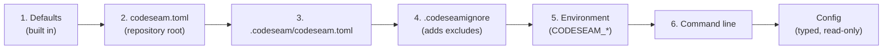

# Configuration

This document describes how to configure Codeseam: where settings come from, each setting, and the rules that Codeseam checks.

## Where settings come from

Codeseam reads settings from six sources. A later source replaces the values of an earlier source.



Codeseam checks each source before it merges it. If a value is not correct, Codeseam stops with exit code 2. The message names the source, the setting, the expected type and the value. An example:

```text
codeseam.toml: output.root must be a string, not 5
```

When all sources are merged, Codeseam makes one read-only `Config` object. The `config_hash` in `manifest.json` identifies the merged settings of a run.

## Create a configuration file

1. Go to the root directory of your repository.
2. Run `codeseam init`.
3. Edit the new `codeseam.toml` file.

`codeseam init` also creates `.codeseamignore`. To skip that file, add `--no-ignore`.

## Settings

Codeseam accepts only the sections and settings in this table. An unknown section or setting is an error.

| Setting | Type | Default | Meaning |
|---|---|---|---|
| `project.repo_root` | string | `"auto"` | The directory to analyse. `auto` is the repository root. A path must be inside the repository. |
| `output.root` | string | `".codeseam/reports"` | The directory for the reports. |
| `selection.include` | glob or list of globs | `["**/*"]` | The files to analyse. |
| `selection.exclude` | glob or list of globs | `[]` | The files to skip, in addition to the built-in excludes. |
| `agent_summary.max_targets` | integer, 0 or more | `0` | The maximum number of findings in `summary.md`. `0` means no limit. |
| `cache.enabled` | `true` or `false` | `true` | Use the persistent cache. |
| `cache.path` | string | `".codeseam/cache"` | The directory for the cache. |
| `relations.split_test` | `true` or `false` | `true` | Do not compare test code with non-test code. |
| `semantics.mode` | `off`, `auto`, `project` or `required` | `"off"` | Use the TypeScript semantic provider. Refer to [Languages](languages.md#the-typescript-semantic-provider). |
| `semantics.trust_project_code` | `true` or `false` | `false` | Let the semantic provider load tools from the analysed repository. |
| `assessment.*` | numbers | Refer to [Assessment settings](#assessment-settings) | The thresholds of the assessment. |

An example `codeseam.toml`:

```toml
[selection]
include = ["src/**", "lib/**"]
exclude = ["src/generated/**"]

[agent_summary]
max_targets = 20

[relations]
split_test = true
```

## Select files

Codeseam always skips these files and directories, even when `selection.include` matches them:

- version control and tool directories: `.git/`, `.codeseam/`, `.cache/`, `.venv/`, `venv/`, `__pycache__/`, `.yarn/`;
- build and package output: `build/`, `dist/`, `coverage/`, `.next/`, `.nuxt/`, `node_modules/`, `vendor/`;
- fixtures: `fixtures/`, `__fixtures__/`;
- generated files: `generated/`, `*.generated.*`, `.pnp.*`;
- minified files, source maps and lock files.

Codeseam also skips the files that Git ignores.

To see the full list, run `codeseam analyze --show-exclusions`. To see which files Codeseam analyses and why it skips each other file, run `codeseam analyze --explain-files`.

To skip more files, use one of these methods:

- Add patterns to `selection.exclude`.
- Add one pattern on each line of `.codeseamignore`. Lines that start with `#` are comments.
- Add `--exclude <pattern>` to the command. You can use this option more than one time.

## Environment variables

| Variable | Setting |
|---|---|
| `CODESEAM_REPO_ROOT` | `project.repo_root` |
| `CODESEAM_OUTPUT_ROOT` | `output.root` |
| `CODESEAM_CACHE_ENABLED` | `cache.enabled` (`true` or `false`) |
| `CODESEAM_CACHE_PATH` | `cache.path` |

The value of a path variable is always a path. For example, `CODESEAM_OUTPUT_ROOT=5` is the directory `5`.

## Command-line options

| Option | Setting |
|---|---|
| `path` or `--repo-root` | The repository to analyse. Use one of the two, not both. |
| `--include <pattern>` | `selection.include` |
| `--exclude <pattern>` | Adds to `selection.exclude` |
| `--semantic-mode <mode>` | `semantics.mode` |

## Rules that Codeseam checks

Codeseam checks these rules before it reads or writes a file:

- Each setting has the correct type.
- `project.repo_root` is inside the repository. It can select a subdirectory, but not a directory outside.
- `output.root` and `cache.path` are not the repository root, and not a parent of it.
- If `output.root` or `cache.path` already exists, Codeseam must own it. Codeseam owns a directory that it made, an empty directory, or a directory that contains the file `.codeseam-owned`.
- `semantics.mode = "required"` needs `semantics.trust_project_code = true`.

**CAUTION:** Codeseam deletes old report files in `output.root` and old cache files in `cache.path`. Do not set these to a directory that contains your own files. The ownership rule prevents this, but use a new directory to be safe.

## Assessment settings

The `[assessment]` section changes the thresholds that decide the review tier. Each value must have the same type as its default. An unknown key is an error.

```toml
[assessment]
recommended_edit_threshold = 0.42
review_candidate_threshold = 0.12

[assessment.fit]
high_hole_count_at = 4
```

The main settings are:

| Setting | Default | Meaning |
|---|---|---|
| `recommended_edit_threshold` | 0.42 | The recommendation score that a `recommended_edit` needs. |
| `review_candidate_threshold` | 0.12 | The review score that a `review_candidate` needs. |
| `high_band_threshold` | 0.75 | The score at which a part of the assessment is `high`. |
| `medium_band_threshold` | 0.45 | The score at which a part of the assessment is `medium`. |
| `risk_block_threshold` | 0.65 | The risk at which Codeseam does not recommend an edit. |
| `cost_block_threshold` | 0.65 | The abstraction cost at which Codeseam does not recommend an edit. |

The groups `[assessment.detection]`, `[assessment.fit]`, `[assessment.payoff]`, `[assessment.semantic_caps]`, `[assessment.semantic_evidence]` and `[assessment.relation_evidence]` contain more settings. Their names and defaults are in `src/codeseam/analysis/assessment/policy.py`.

**CAUTION:** The labelled corpus measures only 12 of these settings. Before you change a setting, measure the effect with `make bench`. Refer to [Evaluation](evaluation.md).
