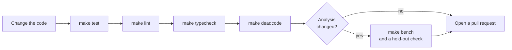

# Contributing

This document tells how to set up a development environment, make a change, and check it.

## Set up

1. Install Python 3.12 or later, and [uv](https://docs.astral.sh/uv/).
2. Clone the repository and install the dependencies:

   ```bash
   git clone https://github.com/zerowarden/codeseam.git
   cd codeseam
   uv sync
   ```

3. Make sure that the tests pass:

   ```bash
   make test
   ```

**NOTE:** Some semantic-provider tests need Node.js and the `typescript` package. Without them, these tests are skipped.

## The development loop



## Make targets

| Target | Does |
|---|---|
| `make test` | Runs the tests with pytest. |
| `make lint` | Runs ruff. |
| `make format` | Formats the code with ruff. |
| `make typecheck` | Runs mypy (strict) and basedpyright on `src/` and `tests/`. |
| `make deadcode` | Runs vulture to find code that nothing uses. |
| `make check` | Runs lint, typecheck, test and deadcode. |
| `make bench` | Scores the labelled corpus. Refer to [Evaluation](evaluation.md). |
| `make analyze` | Analyses a repository. Use `ANALYZE_ARGS="--repo-root /path"`. |
| `make profile` | Profiles an analysis run. Use `PROFILE_ARGS`. |

Run `make test`, `make lint`, `make typecheck` and `make deadcode` before each pull request. All four must pass.

## Code conventions

- **Tools.** Use `uv` to run all commands.
- **Size.** Keep functions and modules small and specific. Remove code that nothing uses.
- **Shared code.** Put helpers that more than one package uses in `src/codeseam/platform/`.
- **Enums.** Use enums inside the code. Compare an enum with an enum, not with a string. Use `.value` only where data goes into or out of JSON or a file. Do not use `str(enum)`.
- **Types.** All code has type annotations. mypy runs in strict mode.
- **Layers.** Keep the import rules in [Architecture](architecture.md#layers).
- **Languages.** Keep language rules in the adapters. The `analysis/` package must not know any syntax.
- **Determinism.** A result must not depend on the order of files or on other files. Sort before you choose.

## Tests

- Put a test next to the code area that it tests, in `tests/`.
- When you test more than one case of one behaviour, use `pytest.mark.parametrize`.
- Shared test helpers are in `tests/helpers.py` and `tests/factories.py`. For example, `extract_source()` runs a language adapter on a source string.
- A test must check behaviour, not the internal structure.

When you change the analysis, also do these steps:

- **Language parity.** If you change one adapter, add a case to `tests/test_adapter_parity.py`. Refer to [Languages](languages.md#the-parity-test).
- **Benchmark.** Run `make bench`. If it finds a regression, fix it. If it shows only improvements, update the baseline. Refer to [Evaluation](evaluation.md#accept-a-change).
- **Held-out check.** For a change to candidates, scores or rules, check real third-party code. Refer to [Evaluation](evaluation.md#check-held-out-code).

## Cache data

Cache keys include a fingerprint of all Codeseam source files. Thus a change to the code makes the old cache entries invalid. You do not have to change a cache version by hand.

If you change the format of a cached value without a code change (for example, a resource file), change the version name in `src/codeseam/version.py`.

## Documentation

The documents in `docs/` use ASD-STE100 Simplified Technical English. Refer to [the writing rules](README.md#writing-rules-for-these-documents).

When you change behaviour that a document describes, change the document in the same pull request.

## Review findings

`REVIEW.md` records a full review of the code and every fix since. When you fix a recorded item, move it to the **Completed fixes** section with what changed and how you checked it.
