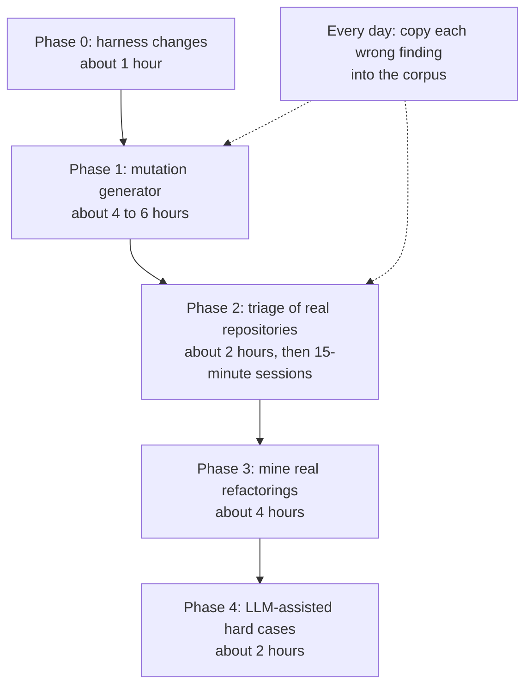
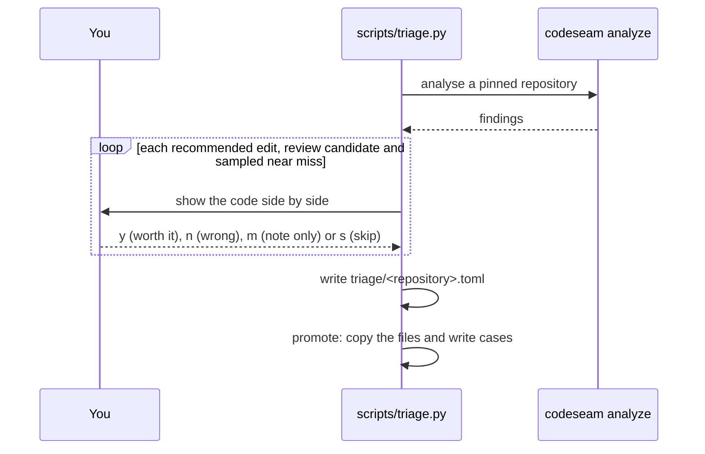

# Corpus growth plan

This document is the plan to grow the labelled corpus. The plan works with little data, no known data source, and little time to write cases by hand.

For how the corpus and the benchmark work today, refer to [Evaluation](evaluation.md).

## Why the corpus must grow

The corpus has 35 cases: 18 positive and 17 negative.

| Category | Python | TypeScript | Recommended | Surfaced |
|---|---|---|---|---|
| Type-1 | 2 | 2 | 4/4 | 4 |
| Type-2 | 2 | 2 | 2/4 | 4 |
| Type-3 | 2 | 1 | 0/3 | 3 |
| Type-4 | 2 | 1 | 0/3 | 1 |
| Partial | 1 | 1 | 2/2 | 2 |
| Scattered rule | 1 | 1 | 0/2 | 2 |
| Negative | 9 | 8 | none recommended | — |

These numbers cause three problems:

1. **The error is too large.** With 3 cases, one case moves recall by 33 points. With 30 cases, the 95% interval is about ±18 points.
2. **Most settings are not measured.** Only 12 of the 72 assessment settings change a result when they move by 30%. The corpus cannot tell if the other 60 values are correct.
3. **Type-3 recall is 0.** Codeseam finds the near-miss clones, but never recommends them. Before you change this, you must be able to measure the change.

## Constraints

The plan must work with these constraints:

- There is not much data.
- The location of good labelled data is not known.
- There is little time to write cases by hand.

Thus the plan prefers cases with a label that is known by construction, and cases that take seconds to label.

## The plan



| Source | Gives | Label comes from | Cost |
|---|---|---|---|
| Mutation generator | Many graded cases in both languages | The construction rule | Build once, then free |
| Triage of real repositories | Real false positives and near misses | Your decision, seconds per finding | 15 minutes per session |
| Mined refactorings | Real positives, independent of Codeseam | The developer who removed the copy | Half a day to set up |
| LLM-assisted cases | Type-4 cases and hard negatives | A specification that you write first | About 2 hours, with review |

## Phase 0: change the harness (about 1 hour)

Do these changes before you add data. They make the other phases possible.

1. **Match on functions, not only files.** At this time, `tests/benchmark.py` keeps only the file part of each member (`file:function`). A target matches a case if its files are a subset of the case's files. Thus two cases cannot share a file, and same-file clones cannot be labelled. Use the `locations` of each target (file and symbol). Keep file-only matching for `file:*` members.
2. **Add optional fields** to `labels.toml`. Old cases stay correct without them:

   ```toml
   [[case]]
   id = "G-PY-s07-t3-ins2"
   category = "type-3"
   kind = "gen: insert 2 statements into a 12-statement body"
   expect = "positive"            # positive, negative or probe
   min_tier = "review_candidate"  # optional floor for a positive
   max_tier = "maintenance_note"  # optional ceiling for a negative
   split = "calibration"          # calibration or holdout
   source = "gen:mutate.py@v1 seed=click/core.py:_main"
   members = ["gen/py/s07/a.py:_main", "gen/py/s07/b.py:_main"]
   ```

   | Field | Use |
   |---|---|
   | `expect = "probe"` | A case without a correct answer. It only shows if a setting is active. |
   | `min_tier`, `max_tier` | A result outside these limits is a regression. |
   | `split` | `--sweep` and `--sensitivity` use only `calibration` cases. Never tune on `holdout` cases. |
   | `source` | Where the case came from, so that you can report each source separately. |

3. **Add `--corpus <path>`** so that the generated, triaged and mined corpora each have their own baseline. The hand-written corpus stays the regression gate.

## Phase 1: mutation generator (about 4 to 6 hours)

A generator takes real functions (**seeds**) and changes them with known edits (**operators**). The label of each case comes from the operator, so it is known before Codeseam runs. This idea comes from the mutation and injection framework of Roy, Cordy and Svajlenko.

### Files

| File | Does |
|---|---|
| `tests/benchgen/seeds.toml` | Lists about 20 Python and 20 TypeScript seed functions. Each has 8 to 25 top-level statements. Records the repository, version, path and licence of each seed. |
| `tests/benchgen/mutate_py.py` | Applies operators to Python with `ast` and `ast.unparse`. |
| `tests/benchgen/mutate_ts.py` | Applies operators to TypeScript by node spans from `tree-sitter-typescript`. |
| `tests/benchgen/generate.py` | Writes the corpus and its `labels.toml`, with a fixed random seed. It must not import Codeseam. |

Take seeds from packages with a permissive licence, for example click, attrs and rich for Python, and zod and date-fns for TypeScript. Keep a `NOTICE` file for them.

**CAUTION:** Do not take seeds from `_pytest`, `pygments` or `jinja2`. They are the held-out check. Seeds from them leak into that check.

### Operators and labels

Write the label rules in `generate.py` before the first run. The results of Codeseam must never change them.

| Category | Operator | Label |
|---|---|---|
| Type-1 | Change the layout; add comments. | Positive, `recommended_edit` expected |
| Type-2 | Rename locals and parameters; change literal values. | Positive, `recommended_edit` expected |
| Type-3 ladder | Insert, delete or change 1, 2 or 3 statements. | 1 or 2 statements: positive with `min_tier = "review_candidate"`. 3 statements: `probe`. |
| Partial | Copy a block of 3, 4, 5 or 8 seed statements into two unrelated host functions. | 3 statements: negative. 5 or more: positive. 4: `probe`. |
| Scattered rule | Copy 3 or 4 guard statements into 3 files, in a different order. | Positive |
| Negative | Change one operator (`+`/`-`, `<`/`<=`, `and`/`or`); add `not`; swap a call for its opposite (`add`/`remove`, `min`/`max`); change the return value; swap arguments that do not commute. | Negative, `max_tier = "maintenance_note"` |
| Payoff ladder | Make 2, 3, 4 or 5 copies, in 1 to 4 files; make the body tiny, medium or large. | `probe` |

A **ladder** is a set of cases that differ in one step, for example 1, 2 and 3 inserted statements. Ladders put cases on both sides of a threshold. That is how a setting becomes measured.

### Rules that keep the cases clean

1. **Check the seeds first.** Run Codeseam on the seeds alone. Remove each seed that is part of a finding at `maintenance_note` or higher. Otherwise an unplanned clone between two seeds lowers the precision.
2. **Use one variant of each seed in one build.** Build shard *j* with operator *j* on every seed. If all variants of a seed are in one build, Codeseam puts them in one cluster. Then the target is larger than each case, and no case matches.
3. **Keep the density low.** Codeseam ignores shingles that more than 16 functions share, and block windows that more than 8 functions share. Too many similar variants change the candidate search itself.
4. **Split by seed.** Put every variant of a seed in the same split. Send the seeds with `hash(seed) % 5 == 0` to `holdout`.
5. **Read a sample.** Read about 10% of the variants before you commit them, about 15 minutes. Make sure that each label agrees with its rule.

**Result:** 40 seeds with about 12 operators give about 480 cases. About 100 of them are holdout cases.

## Phase 2: triage of real repositories (about 2 hours, then 15-minute sessions)

A triage script shows the findings of Codeseam on real code. You decide each one with one key. Your decisions become cases.



1. **Run.** `scripts/triage.py run <repository>@<tag>` analyses a pinned checkout. Use 2 Python and 2 TypeScript repositories. Do not use the three held-out packages.
2. **Show.** The script shows every `recommended_edit` and `review_candidate`. It also shows a random sample of `maintenance_note` findings with high relatedness. These are the near misses.
3. **Decide.** Press one key for each finding. Use no more than 30 seconds. When you are not sure, press `s`.
4. **Promote.** `scripts/triage.py promote` copies the member files into `tests/fixtures/benchmark_real/<repository>/`. It writes cases with function-level members and `source = "triage:<repository>@<tag>"`. A full repository goes to one split.

Aim for about 80 decisions for each repository, and promote 30 to 40 cases. Most of them will be `n` and `m` cases.

**CAUTION:** Triage measures only false positives and near misses. Code that Codeseam did not show never becomes a case. Do not report recall from triaged cases.

## Phase 3: mine real refactorings (about 4 hours)

When a developer replaces duplicated code with one new function, the code before the change is a real positive. A real developer labelled it, and the label does not depend on Codeseam.

1. Run [RefactoringMiner](https://github.com/tsantalis/RefactoringMiner) on the history of about 10 repositories. It is MIT licensed, and it lists support for Python, TypeScript and JavaScript.
2. Keep each "Extract Method" refactoring where the new function replaces code in two or more methods.
3. Take the methods from the parent commit as a positive case.
4. Check the first results by hand. The Python support of RefactoringMiner is new.

Alternatives: [PyRef](https://github.com/PyRef/PyRef) for Python (it needs pandas below 2.0), and [RefDiff](https://github.com/aserg-ufmg/RefDiff) for JavaScript.

Expect 20 to 30 good cases from about 10 repositories. These are the only cheap cases that measure recall on real code.

## Phase 4: LLM-assisted hard cases (about 2 hours)

Use a language model only for two kinds of case: Type-4 clones (same behaviour, different code) and hard negatives (same shape, different business rule). Obey these rules:

1. Write the specification and the label before you ask the model.
2. Never show the model Codeseam output or Codeseam thresholds.
3. Never ask for "cases that Codeseam misses". That trains the tool on its test.
4. Read every case before you commit it.
5. Tag each case with `source = "llm:<model>"`. Report the metrics with and without these cases.

## Data sources not to use

| Source | Reason |
|---|---|
| BigCloneBench, CodeXGLUE clone tasks | Java and C/C++ only. A 2025 study found that 93% of a sample of its weak Type-3 and Type-4 pairs had wrong labels ([Krinke and Ragkhitwetsagul](https://arxiv.org/abs/2505.04311v1)). |
| SemanticCloneBench, GPTCloneBench | Some Python, no TypeScript. Labels mean "similar", not "worth a refactor". The licence and download were not confirmed. At most, use 20 to 30 Python pairs as Type-4 probes ([GPTCloneBench](https://arxiv.org/abs/2308.13963v2)). |
| Project CodeNet | Solutions to one problem are not refactoring targets. The dataset licence was not confirmed. |
| Pyclone | A generator, not a dataset. It labels operator changes as clones, but Codeseam must treat them as negatives. |

No labelled clone benchmark for JavaScript or TypeScript was found.

## Targets

| Measure | Target | Reason |
|---|---|---|
| Positives for Type-2, Type-3 and scattered rule | 30 or more for each language | An error of about ±18 points instead of ±33. |
| Negatives | 40 or more, spread over the negative operators | Precision must stay measured. |
| Holdout | About 20%, split by seed or by repository | An honest check after tuning. |
| Unmeasured settings | Fewer than 60, after each batch | The purpose of the work. |

After each batch, run `make bench BENCH_ARGS="--sensitivity"` on the calibration split. Record the number of unmeasured settings. A setting that changes only `probe` cases is active, but it is not calibrated. A setting that stays unmeasured after all phases is a candidate to remove. Refer to [Rules must earn their place](evaluation.md#rules-must-earn-their-place).

## Pitfalls

1. **File-only matching.** Until Phase 0 is done, a case can only name files. Two cases in one file conflict.
2. **The subset rule.** A target that covers only some files of a positive case still counts as a hit. A correct target that also includes one function outside the case does not count.
3. **Unlabelled code.** Precision counts every unlabelled recommended edit as false. A generated or mined corpus must have no clones outside its cases. Use the seed check, and label every recommended finding in the triaged files.
4. **Tiers.** Recall counts only `recommended_edit`. Negatives allow `review_candidate`. Use `min_tier` and `max_tier` so that a change that helps recall cannot hide a loss of precision.
5. **Path roles.** Directory or file names such as `test`, `tests`, `spec`, `*.test.ts`, `examples` or `generated` add caps. Do not use them in generated paths unless a case tests a cap.
6. **Synthetic is not real.** Keep the hand-written corpus as the regression gate. Keep the held-out read of `_pytest`, `pygments` and `jinja2` as the last check. Give each corpus its own baseline.

## Schedule

| When | Step | Time |
|---|---|---|
| Week 1 | Phase 0: harness changes | about 1 hour |
| Week 1 | Phase 1: generator for Python, then TypeScript; seed check; sample read; first sensitivity run | 4 to 6 hours |
| Week 2 | Phase 2: triage script | about 2 hours |
| Week 2 | Phase 2: triage sessions and promotion | 4 × 15 minutes, then 30 minutes |
| Month 1 | Phase 3: mined refactorings | about 4 hours |
| Month 1 | Phase 4: LLM-assisted cases, with review | about 2 hours |
| Always | Copy each wrong finding from daily use into the corpus | — |

## Sources

- Krinke and Ragkhitwetsagul, ["How the Misuse of a Dataset Harmed Semantic Clone Detection"](https://arxiv.org/abs/2505.04311v1) (2025).
- Alam et al., ["GPTCloneBench"](https://arxiv.org/abs/2308.13963v2) (ICSME 2023).
- Duncan et al., ["Pyclone: A Python Code Clone Test Bank Generator"](https://par.nsf.gov/servlets/purl/10310332).
- Svajlenko and Roy, [Mutation and Injection Framework](https://clones.usask.ca/pubfiles/articles/SvajlenkoMutationFrameworkTSE.pdf); Roy and Cordy, [A Mutation/Injection-based Automatic Framework](https://www.cs.usask.ca/~croy/papers/2009/RC_Mutation09_Framework.pdf) (2009).
- [RefactoringMiner](https://github.com/tsantalis/RefactoringMiner), [PyRef](https://github.com/PyRef/PyRef), [RefDiff](https://github.com/aserg-ufmg/RefDiff).
