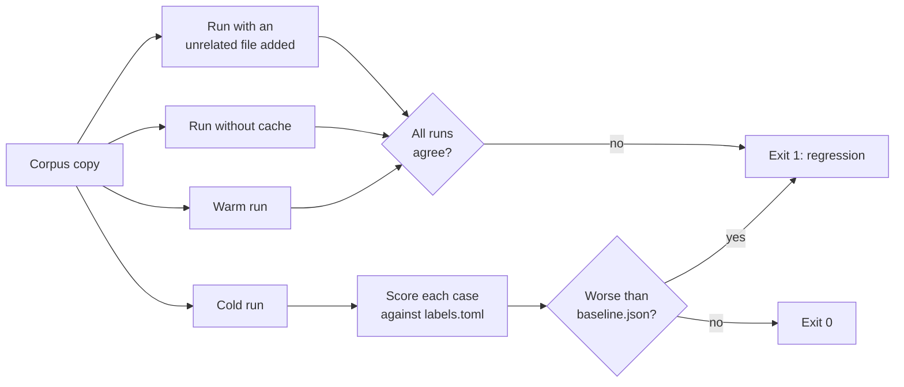

# Evaluation

This document tells how to measure the effect of a change. Codeseam has a labelled corpus, a benchmark that scores it, and a method to check results on code that the corpus does not contain.

## Why measure

Codeseam makes decisions with many thresholds and rules. A small change to one of them can make a good finding disappear, or a bad finding appear. The benchmark finds these effects before a change is merged.

**CAUTION:** Do not change a threshold, a weight or a rule without a benchmark run. Every pull request that changes the analysis must show its effect.

## The labelled corpus

The corpus is in `tests/fixtures/benchmark/`:

| Path | Contents |
|---|---|
| `py/` | Python source files with known repetitions. |
| `ts/` | TypeScript source files with known repetitions. |
| `labels.toml` | The answer key. It was written before the first run of the tool. |
| `baseline.json` | The results of the last accepted run. |

Each case in `labels.toml` names a group of functions and what Codeseam must do with them:

```toml
[[case]]
id = "PH1"
category = "partial"
kind = "partial clone: shared validation and settings block"
expect = "positive"
members = ["py/jobs/import_job.py:run_import", "py/jobs/export_job.py:run_export"]
```

| Field | Meaning |
|---|---|
| `id` | A short ID. `P` is Python, `T` is TypeScript. |
| `category` | `type-1`, `type-2`, `type-3`, `type-4`, `partial`, `scattered-rule` or `negative`. The benchmark reports recall for each category. |
| `kind` | A short description. |
| `expect` | `positive`: the code must surface as a refactor target. `negative`: the code looks similar but must not be a recommended edit. |
| `members` | `file:function` names. `file:*` means all functions in the file. |

A negative case can be a maintenance note or an observation. It must never be a recommended edit.

## Run the benchmark

```bash
make bench
```

The benchmark copies the corpus into a temporary directory and analyses it. Then it compares the result with `baseline.json`.



The benchmark reports these values:

| Value | Meaning |
|---|---|
| `cases` | The highest review tier that each case reaches. |
| `recommended_precision` | The part of the recommended edits that match a positive case. |
| `recall` | For each category: how many positive cases are recommended, and how many surface at all. |
| `negatives_surfaced` | The negative cases that surface as a maintenance note or observation. |
| `stability` | If cold, warm and uncached runs agree, and if an unrelated new file changes nothing. |

A change is a **regression** in these conditions:

- A positive case drops to a lower tier.
- A negative case becomes a recommended edit.
- The recommended precision falls.
- The results are not stable.

## Accept a change

When the benchmark shows only improvements, accept the new results:

```bash
make bench BENCH_ARGS=--update
```

This command writes a new `baseline.json`. Commit it with the change.

## Add a case

1. Write the source files in `tests/fixtures/benchmark/py/` or `tests/fixtures/benchmark/ts/`.
2. Write the case in `labels.toml` before you run the tool. Decide `expect` from the code, not from the result.
3. Run `make bench`.
4. If the result is correct, run `make bench BENCH_ARGS=--update`.
5. If the result is not correct, keep the case. Fix the analysis, or record the case as a known limit.

**NOTE:** A good case comes from a real false result. When Codeseam makes a wrong finding on real code, copy the smallest example into the corpus as a case.

## Calibration

All assessment thresholds are in `AssessmentPolicy` (`analysis/assessment/policy.py`). You can change them in `codeseam.toml`. Refer to [Configuration](configuration.md#assessment-settings).

The benchmark can test a value before you change the default:

| Command | Does |
|---|---|
| `make bench BENCH_ARGS="--set fit.high_hole_count_at=5"` | Scores the corpus with one changed value. |
| `make bench BENCH_ARGS="--sweep recommended_edit_threshold=0.3,0.42,0.5"` | Scores the corpus once for each value. |
| `make bench BENCH_ARGS=--sensitivity` | Moves each numeric setting by -30% and +30%. Lists the settings that change a result. |

At this time, the corpus measures 12 of the 72 assessment settings. The other settings do not change any case within 30%. For these settings, use held-out code (refer to the next section).

**Recorded decisions:**

- `fit.high_hole_count_at` is 4. On held-out code, 4 finds three more real duplicates, and adds no false findings.
- The risk weight of `OPERATOR_DELTA` is 0.50. With this value, every operator change in the corpus has a lower confidence than every real Type-2 or Type-3 pair.

## Check held-out code

The corpus is small. Check a change also on real code that the corpus does not contain:

1. Copy some third-party packages into a new directory. For example, copy `_pytest`, `pygments` and `jinja2` from a virtual environment (about 177,000 lines).
2. Analyse the directory before and after your change.
3. Compare the recommended edits and review candidates.
4. Read the code of each finding that your change adds or removes. Decide if it is correct.
5. Record the result in the pull request.

Also analyse the Codeseam repository itself (`make analyze`). A real duplicate in Codeseam is a good test case, and a good thing to fix.

## Rules must earn their place

A rule that changes a decision, for example a semantic cap, must show that it helps:

1. Turn off the rule.
2. Run the benchmark, the held-out check and the self-scan.
3. Keep the rule only if one of these measurements becomes worse without it.

This method is an **ablation**. It removed many rules that had no measurable effect, or that made the results worse.
