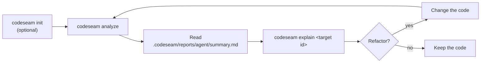

# Getting started

This guide shows how to install Codeseam, analyse a repository, and read the results.

## What Codeseam does

Codeseam reads the source files of a repository. It finds functions that repeat the same code, or the same idea. Then it decides which repetitions are worth a refactor.

Codeseam supports these languages:

- Python
- TypeScript and TSX
- JavaScript and JSX

Codeseam is not a linter and not an automatic refactoring tool. It does not change your code. It writes reports that a person or a coding agent reads.

## Requirements

- Python 3.12 or later.
- [uv](https://docs.astral.sh/uv/) to install and run the tool.
- Git is optional. When the repository uses Git, Codeseam skips the files that `.gitignore` excludes.
- Node.js is optional. Codeseam uses it only for the TypeScript semantic provider. Refer to [Languages](languages.md#the-typescript-semantic-provider).

## Install

1. Clone the repository:

   ```bash
   git clone --depth 1 https://github.com/zerowarden/codeseam.git
   ```

2. Go into the new directory and install the dependencies:

   ```bash
   cd codeseam
   uv sync
   ```

3. Make sure that the command works:

   ```bash
   uv run codeseam --help
   ```

## Analyse a repository

The first analysis follows these steps:



1. Go to the root directory of the repository that you want to analyse.

2. Optional: create a configuration file and a `.codeseamignore` file:

   ```bash
   uv run --project /path/to/codeseam codeseam init
   ```

3. Optional: make sure that Codeseam can analyse the repository:

   ```bash
   uv run --project /path/to/codeseam codeseam doctor
   ```

   `doctor` checks the Python version, the configuration, the report and cache directories, the parsers and the files to analyse. It does not analyse the code.

4. Do the analysis:

   ```bash
   uv run --project /path/to/codeseam codeseam analyze
   ```

   To analyse a different directory, give its path: `codeseam analyze /path/to/repo`.

5. Read the summary in `.codeseam/reports/agent/summary.md`. Look at the **Analysis Completeness** section first. A run with no findings means "no repetition" only when its coverage is `complete`.

6. For more data about one finding, use its target ID:

   ```bash
   uv run --project /path/to/codeseam codeseam explain rt_0123456789ab
   ```

**NOTE:** The first analysis reads every file. Later analyses use a cache and are faster. The cache is in `.codeseam/cache`.

## Read the results

Each result is a **finding**. A finding names a group of functions, or blocks of code, that repeat. Each finding has a **review tier**. The tier tells you what to do:

| Review tier | Meaning | What to do |
|---|---|---|
| `recommended_edit` | The repetition is real, the fix is clear, and the risk is low. | Refactor it. |
| `review_candidate` | The repetition is real, but a person must decide. | Read the code, then decide. |
| `maintenance_note` | The repetition is real, but a refactor is not worth it now. | Keep it in mind. |
| `observation` | The repetition is weak or is expected. | No action. |

For each field and file, refer to [Reports](reports.md).

## Useful commands

| Command | What it does |
|---|---|
| `codeseam analyze` | Analyses the repository and writes the reports. |
| `codeseam analyze --explain-files` | Shows which files Codeseam analyses and which it skips. |
| `codeseam analyze --ci` | Prints JSON for a CI job. There is no color and no progress display. |
| `codeseam explain <target id>` | Shows the evidence for one finding. |
| `codeseam explain <target id> --source` | Also shows the source code of the finding. |
| `codeseam cache` | Shows the size and location of the cache. |
| `codeseam cache clear` | Deletes the cache. |
| `codeseam init` | Creates `codeseam.toml` and `.codeseamignore`. |
| `codeseam doctor` | Checks that an analysis can run. It does not analyse the code. Add `--json` for JSON. |

## Next steps

- To change which files Codeseam analyses, refer to [Configuration](configuration.md).
- To learn the words in the reports, refer to [Concepts](concepts.md).
- To learn how Codeseam makes its decisions, refer to [Methodology](methodology.md).
