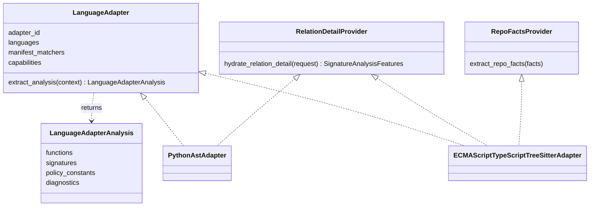
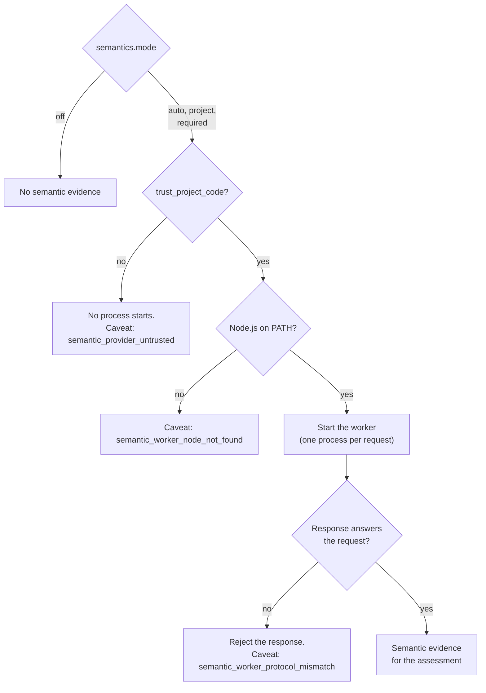

# Languages

This document describes how Codeseam reads each language, the vocabulary that all languages share, and the optional TypeScript semantic provider. The last section tells how to add a language.

## Supported languages

| Language family | Languages | Parser | Adapter |
|---|---|---|---|
| Python | Python | Python `ast` | `adapters/languages/python/` |
| ECMAScript | TypeScript, TSX, JavaScript, JSX | Tree-sitter | `adapters/languages/ecmascript/` |

Codeseam compares functions only inside one language family. A Python function never pairs with a TypeScript function.

## The adapter interface

A language adapter changes source files into language-neutral records. The `analysis/` package then works only with these records.

- `extract_analysis` reads one file and returns its functions, signature records, policy constants and diagnostics.
- `hydrate_relation_detail` is optional. It calculates the expensive relation detail for one function, only when Codeseam compares that function.
- `extract_repo_facts` is optional. It reads project files, for example `tsconfig.json`.

Each adapter declares its **capabilities**:

| Capability | Python | ECMAScript |
|---|---|---|
| `syntax_frontend` | `python_ast` | `tree_sitter` |
| `relation_detail` | yes | yes |
| `policy_constants` | yes | no |
| `repo_facts` | no | yes |
| `compiler_semantics` | no | no |

The reports show these capabilities for each finding (`adapter_capabilities`).

**NOTE:** An adapter must read source only through `read_source(context)`. This function makes sure that the bytes still have the hash from the scan. If the file changed, it raises `SourceChangedError`.

## The shared vocabulary

Module: `analysis/signatures/vocabulary.py`.

The thresholds and rules of the analysis are the same for all languages. Thus each adapter must use the same words for the same code. The shared vocabulary defines these words.

### Statement tokens

Each top-level statement of a function body gets one token:

| Token | Python | TypeScript / JavaScript |
|---|---|---|
| `ASSIGN:BIND` | `x = v`, `x: T = v` | `const x = v`, `let x = v`, `x = v` |
| `ASSIGN:UPDATE` | `x += v` | `x += v`, `x++` |
| `CALL:<call token>` | `f(x)`, `await f(x)` | `f(x);`, `await f(x);` |
| `RETURN:<parameters read>` | `return x`, a lambda body | `return x;`, an arrow function expression body |
| `WITH:<calls>` | `with open(p) as f:` | `with (o) {}` |
| `IF` | `if` | `if` |
| `SWITCH` | `match` | `switch` |
| `LOOP` | `for`, `async for`, `while` | `for`, `for...of`, `for...in`, `while`, `do` |
| `TRY` | `try` | `try` |
| `RAISE` | `raise` | `throw` |
| `DEFINE` | nested `def` or `class` | nested `function` or `class` |
| `BREAK`, `CONTINUE` | `break`, `continue` | `break`, `continue` |
| `PASS` | `pass` | `;` (empty statement) |
| `DECLARE` | `global`, `nonlocal`, `x: T` | none |
| `ASSERT`, `DELETE`, `IMPORT` | `assert`, `del`, `import` | none |
| `EXPR` | other expression statements, for example a docstring | other expression statements |
| `OTHER` | all other statements | all other statements |

### Control kinds

The control vector of a function lists the control structures in its body:

| Control kind | Python | TypeScript / JavaScript |
|---|---|---|
| `BRANCH` | `if`, `match` | `if`, `switch` |
| `LOOP` | `for`, `async for`, `while` | `for`, `for...of`, `for...in`, `while`, `do` |
| `TRY` | `try` | `try` |
| `CATCH` | `except` | `catch` |
| `WITH` | `with`, `async with` | `with` |
| `AWAIT` | `await` | `await` |

### Metrics

| Metric | Counts |
|---|---|
| Branch count | `if`/`elif`, conditional expressions, `case`, and `except`/`catch` handlers. Boolean operators (`and`, `or`) are not branches. |
| Loop count | Loops. Python comprehensions also count. |
| Return count | `return` statements. An expression body of a lambda or arrow function counts as one return. |
| Maximum nesting | The deepest stack of nested control statements. A flat body is 0. |

### Parameters and defaults

- Parameters become roles in call order: `ARG0`, `ARG1`, and so on. Python `*args` and `**kwargs` are parameters too.
- A literal default value has a `CONST_*` role, for example `CONST_NUM` or `CONST_STR`. Any other default has the role `EXPR`.
- An optional TypeScript parameter (`x?: T`) without a value has the default role `CONST_NONE`.
- In the signature shape, Python `*xs: T` is `list[T]`, and `**kw: T` is `dict[str, T]`. This matches TypeScript `...xs: T[]`.

### The parity test

`tests/test_adapter_parity.py` keeps the two adapters equal. It extracts pairs of equivalent Python and TypeScript functions. Then it makes sure that each pair has the same statement tokens, control vector, defaults, graph features and metrics.

**CAUTION:** When you change one adapter, add a parity case for the change. Then change the other adapter until the test passes.

## Python

- Codeseam extracts functions, methods, nested functions and named lambdas (`f = lambda x: ...`).
- A function's container is the class that contains it, for example `Parser` for `Parser.parse`.
- Policy constants are module-level assignments with an `UPPER_CASE` name and a dictionary, list, tuple or set of two or more simple literals.

## TypeScript and JavaScript

- Codeseam extracts function declarations, methods, function expressions and arrow functions.
- Arrow functions in class fields (`handler = () => {}`) take the field name.
- `export default function () {}` has the name `default`.
- Methods of abstract classes and class expressions take the class name, or the variable name, as their container.
- Overload signatures and `.d.ts` declarations are declarations, not implementations. A semantic cap keeps them out of the recommended edits.
- A rest parameter (`...items`) binds the name `items`.

## Semantic roles

Each adapter gives semantic roles to functions. The roles mark code that repeats for a reason, for example a protocol. Some examples:

| Role | Python example | TypeScript example |
|---|---|---|
| `test_code` | a function in a test file | a function in a `.test.ts` file |
| `constructor` | `__init__` | `constructor` |
| `python_special_method` | `__eq__`, `__repr__` | none |
| `typing_overload` | `@overload` | none |
| `overload_signature` | none | an overload signature |
| `abstract_or_interface_stub` | `@abstractmethod`, a body with only a docstring | an abstract method |
| `adapter_forwarder` | none | a body with only one member call, for example `return this.inner.run(x)` |
| `framework_render_surface` | none | a React component that returns JSX |

The role `test_code` comes from the role of the file. For the rules, refer to [Methodology](methodology.md#step-1-scan-the-repository).

## Callsite evidence

A function that returns a function is a **callable factory**. Codeseam records how a file uses its own factories:

| Evidence | Example |
|---|---|
| `callsite_immediate` | `make()()` |
| `callsite_stored_reuse` | `h = make()`, then `h()` two or more times |
| `callsite_pipeline` | `map(make(), items)` |
| `callsite_registered` | `app.add_handler(make())` |
| `callsite_cached` | `cache[key] = make()` |

Both adapters walk the syntax tree and use the shared `CallsiteTracker`. The tracker follows lexical scope. A new assignment to a name, a parameter with the same name, or a different function scope removes the evidence. Calls in comments and strings never count.

## The TypeScript semantic provider

The semantic provider is optional. It uses the TypeScript compiler to add facts that syntax cannot give, for example which function a call goes to.

**CAUTION:** The provider loads the `typescript` package that is installed in the analysed repository. This runs code from that repository. Codeseam starts the provider only when you set `semantics.trust_project_code = true`.

### Modes

| Mode | Behaviour |
|---|---|
| `off` | The provider does not run. This is the default. |
| `auto` | The provider runs if it is trusted and available. It reports ownership facts, but does not run the type checker. |
| `project` | Like `auto`, but the worker also runs the type checker. |
| `required` | Like `project`, but the run fails if the provider cannot give results. This mode needs `trust_project_code = true`. |

### Protocol

The worker is in `src/codeseam/resources/semantic_worker/typescript/`. It reads one JSON request on each line of standard input, and writes one JSON response on each line of standard output.

Codeseam rejects a response in these conditions:

- The `protocol_version`, `request_id`, `language` or project key is not the same as in the request.
- An item has a `signature_id` that was not requested, or the same ID occurs twice.
- The response is larger than 8 MiB.

### Status

The run statistics (`codeseam analyze --timings`) report three different facts:

| Field | Tells |
|---|---|
| `answered_count` | How many requests the worker answered (transport). |
| `compiler_available`, `compiler_versions`, `typechecker_enabled` | If the TypeScript compiler loaded and the type checker ran. |
| `resolved_item_count` | How many functions got semantic facts (coverage). |

## Add a language

1. Make a new package in `src/codeseam/adapters/languages/<language>/`.
2. Write an adapter class with `adapter_id`, `languages`, `manifest_matchers`, `capabilities` and `extract_analysis`.
3. Read source only with `read_source(context)`.
4. Map each statement to the shared vocabulary. Use `statement_token` and `assign_token` from `analysis/signatures/vocabulary.py`.
5. Calculate the control vector, the metrics and the default roles as the tables above describe.
6. Make a statement key and a line span for each top-level statement.
7. Optional: implement `hydrate_relation_detail` to give body trees and data-flow graph features.
8. Add a test-file rule for the language in `adapters/languages/tests_matcher.py`.
9. Register the adapter in `default_language_registry()` in `adapters/languages/__init__.py`.
10. Add parity cases to `tests/test_adapter_parity.py`.
11. Add labelled cases for the language to the benchmark corpus. Refer to [Evaluation](evaluation.md#add-a-case).
