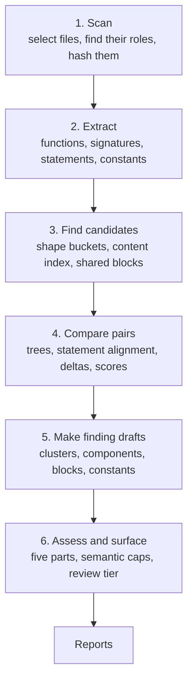
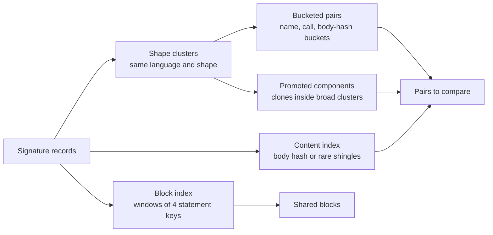
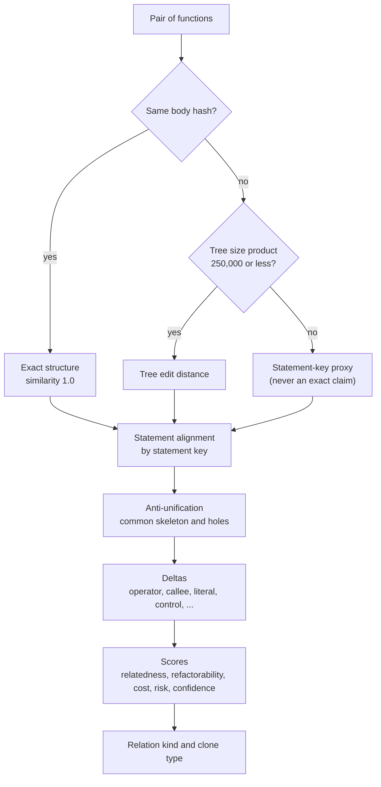
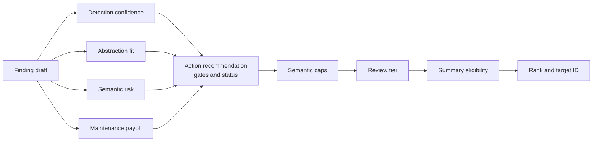

# Methodology

This document tells how Codeseam finds repeated code, compares it, and decides what to recommend. Each step names the source module that does the work.

For the words in this document, refer to [Concepts](concepts.md).

## Overview

Codeseam does an analysis in six steps:

Each step uses a cache. The result of a cached run is the same as the result of a run without a cache.

## Step 1: Scan the repository

Module: `adapters/repository/filesystem.py`.

1. Codeseam walks the repository. It skips the built-in excludes, the configured excludes, and the files that Git ignores.
2. For each file, it finds the language from the file extension.
3. It gives each file a role: `source`, `test`, `fixture`, `generated`, `vendor`, `build_output`, `documentation` or `configuration`.
4. It calculates a SHA-256 hash of the content of each file.

The scan decides the role of a file one time. All later steps use this role.

**Test files.** A file is a test file in these conditions:

- It is in a directory with the name `test`, `tests`, `testing`, `__tests__` or `integration-tests`.
- Python: its name matches `test_*.py`, `*_test.py`, `*_tests.py`, `tests.py` or `conftest.py`, or a pattern in the pytest configuration of the repository (`python_files`, `testpaths`).
- TypeScript and JavaScript: its name ends with `.test`, `.spec`, `-test` or `-spec`, or it is in a `spec` or `specs` directory.

## Step 2: Extract functions and features

Module: `adapters/languages/` (one adapter for each language family).

The adapter parses each file one time. Before it parses a file, it makes sure that the bytes still have the hash from the scan. If the file changed after the scan, Codeseam reports the file as `source_changed` and does not cache its result.

For each function, the adapter extracts:

| Feature | Use |
|---|---|
| Signature shape | Groups functions with the same declared types. |
| Statement tokens | Tell the kind of each top-level statement (`IF`, `LOOP`, `ASSIGN:BIND`, ...). |
| Statement keys and line spans | Align statements by content, and find shared blocks. |
| Body hash | Finds exact copies (Type-1 and Type-2). |
| Call tokens | Compare what each function calls. |
| Control vector | The control structures in the body (`BRANCH`, `LOOP`, `TRY`, `CATCH`, `WITH`, `AWAIT`). |
| Semantic roles | Labels such as `test_code` or `constructor` that can cap a finding. |
| Callsite evidence | How the file uses its own callable factories. |
| Local duplicate blocks | Blocks that repeat inside one function. |

From Python files, the adapter also extracts **policy constants**.

Normalization makes copies with different names look the same:

- Parameters become roles: `ARG0`, `ARG1`, and so on.
- Local variables become `LOCAL0`, `LOCAL1`, and so on.
- Statement keys also remove literal values and names that are not called.

Both adapters use one vocabulary for these features. Refer to [Languages](languages.md#the-shared-vocabulary).

**Relation detail** is the more expensive part of the features. It includes the body tree, the data-flow graph features, and the literal and receiver shapes. Codeseam calculates it only for functions that it will compare, and it caches the result.

## Step 3: Find candidates

Codeseam does not compare every pair of functions. It uses four methods to find the pairs and blocks that are worth a comparison.

### Shape clusters and buckets

Modules: `analysis/assessment/cluster/build.py`, `analysis/relations/candidates.py`.

1. Codeseam groups functions with the same language family and the same signature shape into a cluster.
2. In a cluster, it puts compact functions into buckets. A compact function has 8 or fewer top-level statements and 120 or fewer tree nodes.
3. Bucket keys are: the name, the first word of the name, each call, a payload-builder pattern, and the body hash.
4. Each bucket keeps its first 32 members in location order.
5. Codeseam ranks the pairs from the buckets by their estimated content similarity. It keeps the 400 best pairs of each cluster.

Functions that are too large for buckets meet through the content index. Identical large functions always pair by their body hash.

### Content index

Module: `analysis/relations/content.py`.

The content index finds similar functions with different shapes or sizes. This is the method of SourcererCC.

1. Codeseam makes structural shingles (short sequences of statement and call tokens) for each function.
2. A shingle that more than 16 functions share is too common. Codeseam ignores it.
3. Two functions are candidates if they have the same body hash, or if they share 2 or more rare shingles.
4. A candidate pair becomes a content edge if the Jaccard similarity of its shingle sets is 0.55 or more.
5. Each function keeps its 8 strongest edges. Edges join into components of 12 or fewer functions.

A function with one statement never pairs across shapes.

### Promoted components

Module: `analysis/findings/drafts.py`.

A broad cluster can contain a small group of real clones, for example 3 identical functions among 30 functions with the same shape. Codeseam promotes such a group to its own finding.

### Shared blocks (partial clones)

Module: `analysis/relations/blocks.py`.

Some functions share a large block, but are different elsewhere. Whole-function comparison does not find them. The block index finds them:

1. For each function, Codeseam makes windows of 4 consecutive statement keys.
2. A window that more than 8 functions share is boilerplate. Codeseam ignores it.
3. Two functions that share a window are extended to their longest common run of statements.
4. A run is a shared block if it has these properties:
   - 4 or more statements, and 3 or more different statements;
   - 8 or more source lines in each copy;
   - it is not the full body of both functions, because that is a whole-function clone.
5. Codeseam ignores a leading docstring or directive. Its key is the same in all functions.
6. Codeseam does not report a block between two functions that are already a whole-function clone. It does not mix test code and non-test code.
7. Codeseam makes one finding for each set of functions. The finding lists all the blocks that the set shares.

### Policy constants

Module: `analysis/assessment/cluster/policy_constants.py`.

Codeseam compares module-level constants with `UPPER_CASE` names and structured literal values. It makes three kinds of clusters:

| Match | Meaning | Action |
|---|---|---|
| `identical` | The same name and the same value in more than one module. | Move the constant to one module. |
| `drifted` | The same name, but the values are different. Half or more of the items of the smallest copy must be in all copies. | A person must decide which value is correct. |
| `scattered` | The same value under different names. | A person must decide if the names mean one rule. |

## Step 4: Compare pairs

Modules: `analysis/relations/`.

### Structure

- **Tree edit distance.** Codeseam uses top-down ordered tree edit distance. The trees are flattened, so the calculation does not use recursion. Identical top-level statements can match out of order.
- **Statement alignment.** Codeseam aligns the statement keys of the two functions with a longest common subsequence. Statements that occur in both gaps count as moved, not as holes.
- **Anti-unification.** The aligned statements make a common skeleton. The places where the functions are different are holes. Many holes, or large holes, lower the abstraction fit.

### Deltas and risk

A **delta** is one kind of difference. Each delta has a risk weight. The risk of a pair is the sum of its delta weights, to a maximum of 1.0.

| Delta | Risk weight | Example |
|---|---|---|
| `OPERATOR_DELTA` | 0.50 | `a + b` against `a - b`, or `not x` against `x` |
| `RETURN_VALUE_DELTA` | 0.18 | A different return value |
| `ERROR_HANDLING_DELTA` | 0.18 | A different `try` or `raise` |
| `CONTROL_FLOW_DELTA` | 0.15 | A different `if` |
| `LOOP_DELTA` | 0.14 | A different loop |
| `ARGUMENT_FLOW_DELTA` | 0.12 | Arguments go to different places |
| `CALLEE_NAME_DELTA` | 0.10 | `save()` against `delete()` |
| `LITERAL_VALUE_DELTA` | 0.04 | `"users"` against `"orders"` |

The other deltas are in `analysis/relations/scoring.py`.

**NOTE:** An operator change has the highest weight. Two functions that differ only in one operator look almost identical, but they compute different results.

### Scores

| Score | Meaning |
|---|---|
| Relatedness | How similar the two functions are. A weighted sum of parameter, call, sequence, tree, graph and name similarity. When neither function has evidence for one component, Codeseam removes that component from the sum. It does not score the component as 0 or 1. |
| Refactorability | How easy it is to make one shared function. It uses the size of the common region, the number and size of holes, and the abstraction cost. |
| Abstraction cost | How many parameters and branches a shared function needs. |
| Risk | The sum of the delta weights. |
| Confidence | How much Codeseam trusts the relation. |

### Relation kinds

Codeseam gives each pair one relation kind:

| Relation kind | Meaning |
|---|---|
| `body_identical` | The bodies are the same after normalization. |
| `body_parameterized` | The same skeleton; only values are different. |
| `same_skeleton_different_literals` | The same skeleton; literal values are different. |
| `same_skeleton_different_callees` | The same skeleton; called functions are different. |
| `common_prefix_divergent_tail` | The start is the same; the end is different. |
| `common_suffix_divergent_setup` | The end is the same; the start is different. |
| `common_wrapper_different_core` | The outer code is the same; the core is different. |
| `same_core_different_wrapper` | The core is the same; the outer code is different. |
| `same_statements_different_order` | The same statements in a different sequence. |
| `same_call_set_different_order` | The same calls in a different sequence. |
| `same_argument_flow_different_control` | Arguments go to the same places, but the control flow is different. |
| `argument_normalization_wrapper` | The functions change their arguments the same way, then call the same operation. |
| `none` | No relation. The pair does not count as evidence. |

## Step 5: Make finding drafts

Module: `analysis/findings/drafts.py`.

Codeseam makes a **finding draft** from each source of evidence:

- a shape cluster or a content cluster, profiled by its strongest pair (the **lead pair**);
- a promoted clone component;
- a local duplicate block inside one function;
- a shared block between functions;
- a policy constant cluster.

A draft holds metrics that summarize the evidence: member count, lead pair scores, relation and delta counts, semantic role counts, and line spans. All lead metrics come from one pair. Thus the metrics describe a real pair, not a mix of the best values of different pairs.

## Step 6: Assess and surface

Module: `analysis/assessment/`.

The assessment changes each draft into a finding. It has five parts:

1. **Detection confidence.** Is the relation real? Exact evidence (body hash, local or shared duplicate block, policy constant) gives high confidence. Structural evidence gives a confidence from the lead pair.
2. **Abstraction fit.** Is there one clean abstraction? Fit uses the common region, the holes, the abstraction cost and the stable statements.
3. **Semantic risk.** Can a refactor change the behaviour? Risk comes from the deltas, the semantic roles and the semantic provider (if it runs).
4. **Maintenance payoff.** Is the work worth it? Payoff uses the number of copies, how far they spread across the repository, and the number of lines.
5. **Action recommendation.** Codeseam selects the best action. Each action has gates, for example "low semantic risk" or "stable common region". A failed gate makes the status cautious. A high risk or cost blocks the action.

### Semantic caps

Some code repeats because a protocol or a framework requires it. A **semantic cap** limits the tier of such a finding. Caps apply when most members have one of these properties:

- declarations, interfaces, overloads or abstract stubs;
- trivial bodies (for example, one `return` of a constant);
- membership of a broad cluster that is profiled by few pairs;
- test, example or generated code;
- API surfaces, adapters or forwarders;
- constructors;
- special methods (for example `__eq__` or `__repr__`).

Codeseam keeps a cap only when a measurement shows that it helps. Refer to [Evaluation](evaluation.md#rules-must-earn-their-place).

### Review tier and summary

Codeseam gives the finding a review tier. The rules are in `analysis/assessment/classify.py`:

- `recommended_edit`: an edit action, its preconditions pass, high detection, and real payoff.
- `review_candidate`: a review score above `review_candidate_threshold`, with enough detection and payoff.
- `maintenance_note`: a real relation, but no clear edit.
- `observation`: all other findings.

A finding is **summary eligible** when it is listed and worth an edit. Codeseam decides this on the typed finding, before it writes a file.

Finally, Codeseam ranks the findings and gives each one a target ID. The ID uses the kind of finding and its members, but not the verdict. Thus the ID stays the same when the tier changes.

## Determinism

Codeseam gives the same result for the same input:

- The result does not depend on the order of files, or on other files.
- A run with a warm cache gives the same reports as a run without a cache.
- Cache keys include a fingerprint of the Codeseam source code, the Python version and the parser versions.

The benchmark checks these properties for each change. Refer to [Evaluation](evaluation.md).

## Limits

These limits are known:

- **Type-4 clones.** Code with the same behaviour but a different structure is out of reach.
- **Nested blocks.** Shared blocks are runs of top-level statements. A block copied into a nested scope is not found.
- **Policy constants** come only from Python.
- **Large trees.** Pairs with a tree size product above 250,000 use a statement-key proxy.
- **Calibration.** The labelled corpus measures 12 of the 72 assessment settings. The other settings, and the relation-scoring weights, are set by hand. Refer to [Evaluation](evaluation.md#calibration).
