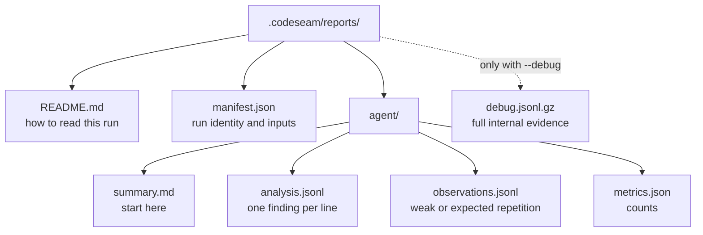
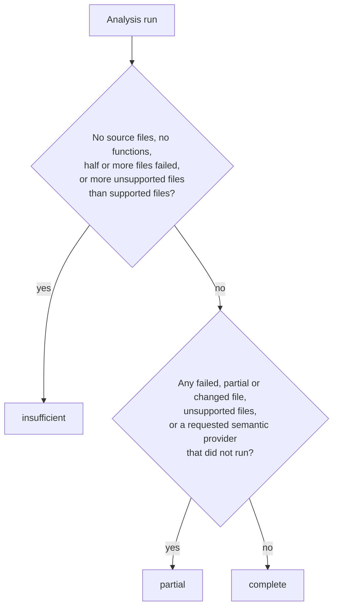

# Reports

This document describes the files that `codeseam analyze` writes, the fields in each file, and the exit codes.

## Where the reports are

Codeseam writes the reports into the output root. The default output root is `.codeseam/reports`. To change it, refer to [Configuration](configuration.md#settings).

Codeseam writes a new run into a staging directory first. It replaces the old reports only when the run is complete. If a run fails or you stop it, the reports of the previous run stay.

## How to read a run

Read the files in this sequence:

1. Read `agent/summary.md`. First read its **Analysis Completeness** section. Then read the findings that are worth your attention, with the suggested action for each.
2. For one finding, run `codeseam explain <target id>`. Add `--source` to show the code.
3. For automation, read `agent/analysis.jsonl`. Each line is one JSON object.
4. Read `agent/observations.jsonl` only if you want the weak signals too.

**NOTE:** `analysis.jsonl` and `observations.jsonl` are lean. They do not contain scores or full metrics. To get all evidence, run `codeseam analyze --debug` and read `debug.jsonl.gz`.

## Files

| File | Contents |
|---|---|
| `README.md` | A short guide for this run, with links to the other files. |
| `manifest.json` | The run ID, the time, the repository root, the configuration hash and the number of selected files. |
| `agent/summary.md` | The summary-eligible findings, in rank order, with the suggested action and the `explain` command for each. |
| `agent/analysis.jsonl` | All findings with the tier `recommended_edit`, `review_candidate` or `maintenance_note`. |
| `agent/observations.jsonl` | All findings with the tier `observation`. |
| `agent/metrics.json` | The counts of findings by tier, action status and type. |
| `debug.jsonl.gz` | Optional. All findings with full metrics, scores and relation pairs. |

## Fields of a finding

Each line of `analysis.jsonl` and `observations.jsonl` has these fields:

| Field | Meaning |
|---|---|
| `target_id` | The stable ID of the finding. Use it with `codeseam explain`. |
| `title` | A short name, for example `Duplicate helper normalize_records`. |
| `review_tier` | The decision: `recommended_edit`, `review_candidate`, `maintenance_note` or `observation`. |
| `action_status` | The status of the action: `recommended_edit`, `cautious_candidate`, `record_shared_concern`, `observe` or `do_not_refactor`. |
| `primary_action` | The recommended action, for example `consolidate_clone`. Refer to [Concepts](concepts.md#findings-and-decisions). |
| `visibility` | `listed` (in the summary), `grouped` (counted only), or `sidecar_only` (in the files only). |
| `summary_eligible` | `true` when the finding is in the summary and CI counts it. |
| `evidence_strength` | How strong the evidence is: `strong`, `moderate` or `weak`. |
| `evidence_classes` | The kinds of evidence, for example `body_structure_similarity` or `duplicate_block`. |
| `assessment` | The bands of the five assessment parts, and the failed gates of the action. |
| `reasons` | Why Codeseam made the finding. |
| `non_claims` | What the finding does not claim. Read these before you edit. |
| `files` | The files of the finding. |
| `locations` | For each member: `file`, `start_line`, `end_line` and `symbol`. |
| `abstraction_kind` | The kind of shared abstraction, for example `extract_helper` or `move_module`. |
| `evidence_kinds` | The sources of evidence, for example `structural_duplicate` or `shared_block`. |
| `refactor_value`, `refactor_safety` | The payoff band and the safety of a refactor. |
| `summary_reason` | Why the finding is, or is not, in the summary. |
| `semantic_guardrails` | The semantic roles of the members, and the reasons for any cap. |
| `structural_relation_pairs` | Optional. The compared pairs, with their relation kind and deltas. |
| `adapter_capabilities` | What the language adapters of these files can do. |

## Metrics

`agent/metrics.json` has these counts:

| Field | Meaning |
|---|---|
| `analysis_target_count` | The number of findings in `analysis.jsonl`. |
| `observation_count` | The number of findings in `observations.jsonl`. |
| `agent_visible_target_count` | The number of summary-eligible findings. |
| `recommended_edit_tier_count` | The number of findings with the tier `recommended_edit`. This number sets the exit code. |
| `recommended_edit_count` | The number of summary-eligible findings with the action status `recommended_edit`. |
| `completeness` | How much of the repository the run covered. Refer to [Completeness](#completeness). |
| `summary.targets_by_review_tier` | The number of findings for each tier. |
| `summary.targets_by_action_status` | The number of findings for each action status. |
| `summary.files_with_targets` | The files that have one or more findings. |

## Completeness

A report without findings means "no repetition worth attention" only when the analysis covered the repository. The `completeness` object in `agent/metrics.json` tells how much the run covered. The summary and the command output show it too.

| Field | Meaning |
|---|---|
| `coverage` | `complete`, `partial` or `insufficient`. |
| `reasons` | Why the coverage is not `complete`. |
| `notes` | Limits that bound the work but leave no code unanalysed, for example candidate pairs that were not compared because they ranked lowest. |
| `files` | The number of selected source files that were `analysed`, `partial` (parsed with syntax errors), `failed` (nothing extracted) or `changed` (edited during the run). |
| `unsupported_source_files` | Source files in languages without an adapter, for example Go or Java. |
| `function_count` | The number of functions that Codeseam extracted. |
| `comparisons` | The pairs compared, the pairs and bucket members that a limit cut off, and the related pairs whose tree similarity was measured or estimated. |
| `evidence_methods` | Each evidence method, and if it `ran`, was `skipped` (nothing to run on) or was `unavailable` (wanted, but could not run). |

**CAUTION:** When the coverage is `partial` or `insufficient`, an empty report does not mean that the code has no repetition. Read the reasons, fix them if you can, and run the analysis again.

Comparison limits do not make a run `partial`. Codeseam compares the candidate pairs with the highest estimated similarity first, so the pairs that a limit cuts are the least likely clones. The `notes` field reports them.

The counts come from the scan and the final results, not from the cache. Thus a warm run reports the same completeness as a cold run.

## The explain command

`codeseam explain <target id>` reads the reports of the last run. It shows the tier, the action, the files, the symbols and the guards of one finding.

| Option | Shows |
|---|---|
| `--source` (or `--verbose`) | The source code of each member. |
| `--evidence` | The evidence kinds and classes. |
| `--pairs --top N` | The N strongest relation pairs. |
| `--json` | The finding as JSON. |
| `--full` | All fields as JSON. |

## Command output and CI

By default, `codeseam analyze` prints a short text summary. Its `Coverage:` line shows the completeness of the run.

- `--format json` prints one JSON object. `--format ndjson` prints one JSON object per line.
- `--output <path>` writes that output to a file.
- `--ci` turns off color and progress, and prints a CI summary. Use `--ci --format json` for a JSON result with a `ci` object.

In CI mode, a run fails when there is a finding with the tier `recommended_edit`.

## Exit codes

| Code | Meaning |
|---|---|
| 0 | The run is complete. There are no recommended edits. |
| 1 | The run is complete. There are one or more recommended edits. |
| 2 | Incorrect input: a configuration error, an incorrect argument, or a problem with the repository root. |
| 3 | An internal error. |
| 130 | You stopped the run (Ctrl-C). The previous reports stay. |

**CAUTION:** Exit code 1 is not an error. It tells a CI job that the repository has code to refactor. If your CI job must not fail for this, accept exit code 1.
